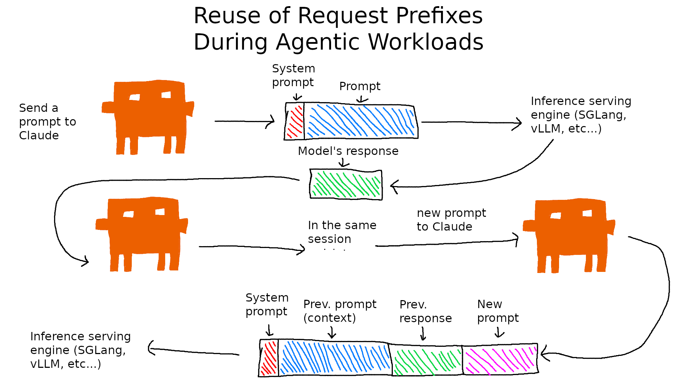
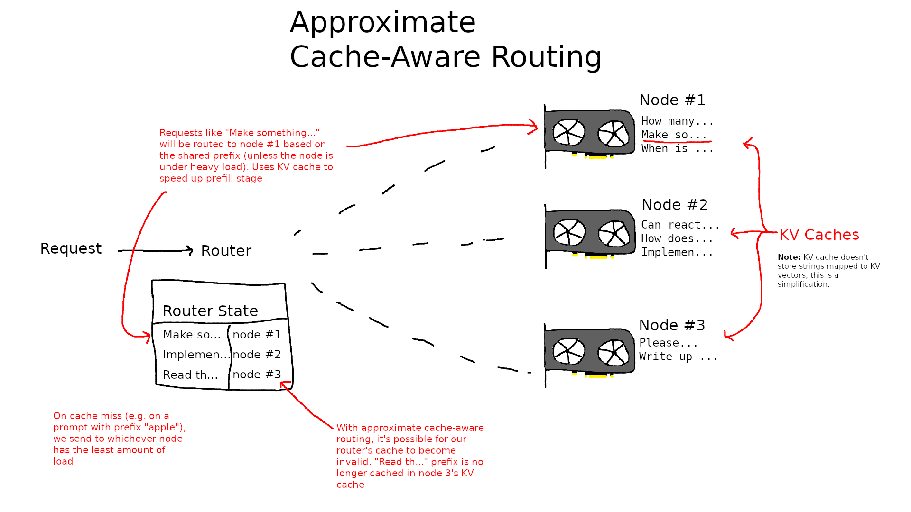
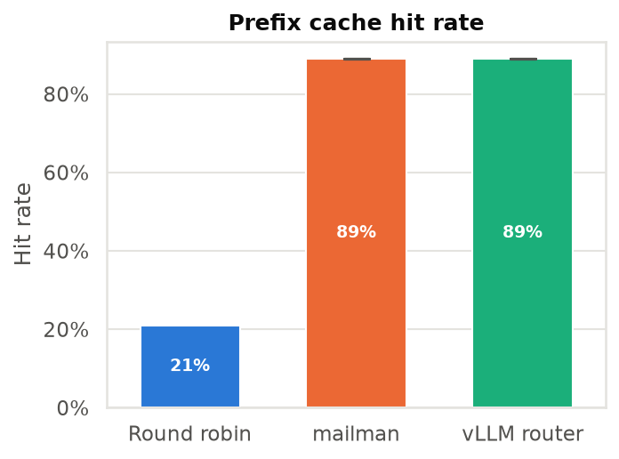
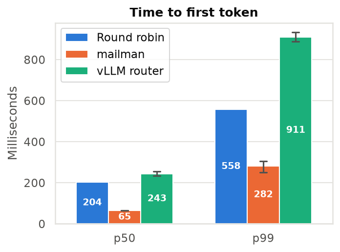
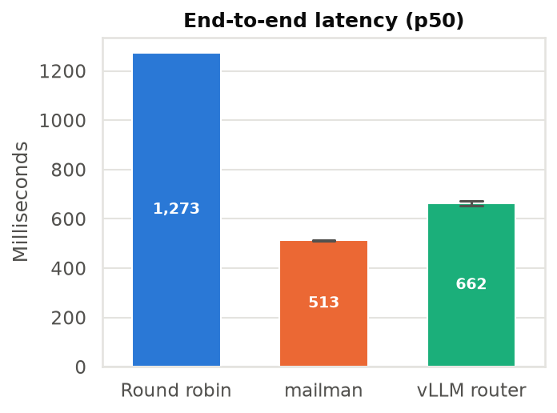
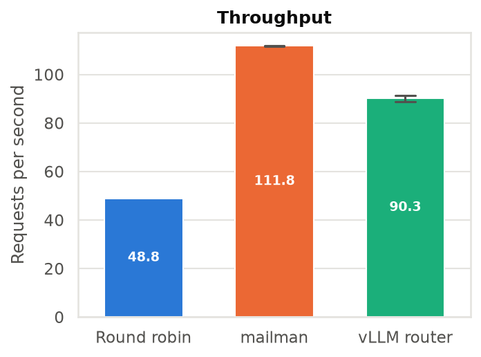

<p align="center"></p>

<p align="center">Mailman: A simple cache-aware router for vLLM</p>

## Contents

- [Design](#design)
  - [Prefix caching in agentic workloads](#prefix-caching-in-agentic-workloads)
  - [Routing across nodes](#routing-across-nodes)
  - [Approximate cache-aware routing](#approximate-cache-aware-routing)
  - [How mailman works](#how-mailman-works)
- [Results](#results)
  - [Compared to vLLM's router](#compared-to-vllms-router)
- [Quick start](#quick-start)
  - [Locally, on CPU](#locally-on-cpu)
  - [On GPUs](#on-gpus)
  - [Without Kubernetes](#without-kubernetes)
- [Configuration](#configuration)
- [`/stats` endpoint](#stats-endpoint)
- [Benchmarking on GPUs](#benchmarking-on-gpus)
- [Troubleshooting](#troubleshooting)

## Design

The goal of this project was to create a simple cache-aware router for vLLM
instances, similar to projects such as [vLLM's router](https://github.com/vllm-project/router/).

### Prefix caching in agentic workloads

When serving agentic workloads, each request in a session carries the
session's previous prompts and responses, so the model has the context of the
conversation so far (Figure 1). Requests from the same session therefore share
a long prefix, and only the newest message at the end is new.

<p align="center"></p>

<p align="center">Figure 1.</p>

vLLM and other inference engines use a KV cache, which stores the key (K) and
value (V) vectors the model computes for each token of a request. Computing
these for the whole prompt is the first phase of inference, called *prefill*.
With prefix caching, if a new request starts with the same tokens as one the
engine has already seen, it can reuse the cached K and V values for that prefix
instead of computing them again.

Skipping that work lets the engine move almost immediately to the second phase,
*decoding*, which generates the response one token at a time. This lowers TTFT
(time to first token), and since the GPU isn't spending time redoing prefill,
it also increases overall throughput.

### Routing across nodes

On a single node there's little need to worry about the state of the cache, since
the cached values from previous requests are very likely to still be there, unless
they've been evicted because large or numerous requests filled the cache. With
multiple nodes, however, the cache is fragmented across them. If one request
from a session is served by one node, these benefits only come from sending the
session's later requests back to that same node, since the other nodes are
unlikely to have seen similar requests.

This is why it matters where requests are sent. The difference
between a poorly and a properly routed request has a significant effect on TTFT
and the other inference metrics.

A common solution to this is *cache-aware routing*. A cache-aware router keeps
track of metadata about previous requests and uses it to decide where to send
future requests, so as to make the most of KV cache locality. This is in
contrast to the simplest form of routing, round robin, which spreads the load
evenly by giving each new request to the next node in turn, with no regard for
cache locality.

### Approximate cache-aware routing

The simplest way to implement cache-aware routing is with a
[radix tree](https://en.wikipedia.org/wiki/Radix_tree), a data structure built
for finding which stored strings share a prefix with a given string. The router uses it
to store previous prompts, each mapped to the node it was sent to. When a new
request comes in and a long enough prefix of it is already in the tree, the router can
assume the node mapped to that prefix likely still has its key and value vectors
in cache, and send the request there.

<p align="center"></p>

<p align="center">Figure 2.</p>

This approach is called *approximate* cache-aware routing, since the router is
*assuming* the node's cache still holds the prefix. It may not, since the
prefix could have been evicted in the meantime.

More complex versions of cache-aware routing exist, where the router receives
cache events from each node, telling it when a given prefix has been added to
or removed from the node's cache. This gives the router a more accurate picture
of the cache state of the whole system, rather than an assumption of it. In
general, though, approximate cache-aware routing is enough to see a significant
improvement over round robin, as the results section shows.

### How mailman works

mailman is a small HTTP proxy written in Rust. It accepts OpenAI chat
completion requests at `POST /chat/completions`, picks a vLLM node for each
one, and forwards it, passing streamed responses through chunk by chunk as
they arrive.

**Finding nodes.** On Kubernetes, mailman watches the EndpointSlices of the
vLLM Service, so it picks up pods as they are added or removed. Outside
Kubernetes it routes to a fixed list of servers from `MAILMAN_BACKENDS`. Either
way, it health-checks every node every 2 seconds, stops routing to a node that
fails, and drops it after 5 failed checks in a row, along with every prefix
routed to it.

**Choosing a node.** For each request, mailman builds a key from the text of
its messages, cut to the first 4 KB, and looks it up in a
[Patricia tree](https://en.wikipedia.org/wiki/Radix_tree#PATRICIA) (a kind of
radix tree) that maps earlier keys to the node each was sent to. If at least
half of the key matches a stored prefix, the request goes to that node.

A shorter match isn't worth acting on. If only a small part of the prompt
matches, such as an opening line many prompts happen to share, a cache hit
would skip very little prefill, while sending every such request to the same
node would pile work onto it. In that case it's better to spread the load, so
the request goes to the node holding the fewest prefixes, which keeps new
sessions evenly balanced across nodes. Either way, the key is then added to the tree
under the chosen node. Once the tree holds more than 100,000 keys, the least
recently used half are dropped.

**Handling failures.** If a node errors or can't be reached before it
responds, mailman marks it unresponsive and tries the next node. Once a
response has started streaming it can't be retried, so a failure mid-stream
ends that request.

**Stats.** mailman also scrapes every node's `/metrics` every 5 seconds and
combines them with its own request counts at `/stats` (see
[`/stats` endpoint](#stats-endpoint)).

## Results

The benchmark ran on a Lambda Cloud instance with 8 NVIDIA A100 80GB GPUs,
using k3s, with one vLLM (v0.33.0) instance per GPU serving Qwen3-8B. Load was
generated with [AIPerf](https://github.com/ai-dynamo/aiperf). It compares three
routers in front of the same vLLM instances, namely round robin, mailman, and
[vLLM's router](https://github.com/vllm-project/router) (v0.1.17) with its
cache-aware policy at default settings. vLLM's router is included as a
performance baseline, an established cache-aware router to measure mailman
against.

mailman and vLLM's router were each run three times, alternating between them,
and round robin once. Every vLLM prefix cache was emptied and the router
restarted before each run. See [Benchmarking on GPUs](#benchmarking-on-gpus) to
reproduce it.

The workload is built to look like agentic traffic. Every request starts with
one of 790 shared 2,000-token prefixes, standing in for the system prompt, tool
definitions and conversation history that an agent resends each turn, followed
by a short 100-token new message. Each prefix is used by 16 requests, and
responses are kept short (32 tokens), since agent turns are mostly long inputs
with short outputs like tool calls. Together the prefixes fill half of the
cluster's KV cache, which is more than any one node can hold, so where a request
is sent decides whether its prefix is cached. Each run sends 12,640 requests,
64 at a time.

One simplification is that the prefixes don't grow the way a real conversation
does, and requests sharing a prefix arrive in random order rather than as
consecutive turns.

<p align="center"></p>

<p align="center">Figure 3.</p>

<p align="center"></p>

<p align="center">Figure 4.</p>

<p align="center"></p>

<p align="center">Figure 5.</p>

<p align="center"></p>

<p align="center">Figure 6.</p>

Both cache-aware routers raised the prefix cache hit rate from 21% to 89%
(Figure 3). This is close to the best possible for this workload. The first
request for each prefix always misses, and the new 100-token message at the end
of every request is never cached, which together cap the hit rate at about 89%.

With most of the prefill skipped on a cache hit, mailman cut median TTFT by 68%
compared to round robin, from 204 ms to 65 ms (Figure 4), cut median end-to-end
latency by 60% (Figure 5), and more than doubled throughput, from 48.8 to 111.8
requests per second (Figure 6). mailman's results varied by less than 2.5%
between runs, except its p99 TTFT, which varied by about 19%.

mailman's p99 TTFT improves less, by 49%. Between 87% and 97% of the slowest 1%
of requests are the first request for their prefix, and all of them arrive in
the first minute, when every prefix is new and no node has it cached yet. These
misses can't be avoided by *any* router, so a cache-aware router can't do much for
them. Leaving them out, mailman brings the p99 TTFT of the remaining requests
from 371 ms with round robin down to 199 ms.

### Compared to vLLM's router

vLLM's router reaches the same 89% hit rate, but its median TTFT is 243 ms,
*slower* than round robin's, and its p99 is 911 ms. Its throughput (90.3 requests
per second) and median end-to-end latency (662 ms) still beat round robin, since
its cache hits make prefill cheap once a request is routed, but trail mailman by
19% and 29%.

The difference comes from how it matches prefixes. mailman matches on the
request's *text*, so it decides where to send a request without contacting any
node. vLLM's router matches on *token IDs*, so before routing it asks the vLLM
instances to apply their chat template and tokenize the request, through each
instance's `/v1/chat/completions/render` endpoint. The vLLM instance I checked
received a render call for *every* request in the run, not just the ones routed
to it, which across 8 instances is about 100,000 extra calls per run. These run
on the same vLLM API server that streams responses and feeds the GPU, and the
router waits for them (up to a one second timeout) before forwarding the
request. That wait is added to every request's TTFT, and it grows
with load. About 3% of requests timed out on the render step and were routed by
load alone.

Tokenizing first is a trade. vLLM's router pays a cost on every request, and
in return it routes more accurately, since it matches exactly what each instance
will cache. Text can differ from what is cached, for example when a chat
template rewrites earlier turns, when instances run different models or
tokenizers, or when requests include images. It also lets vLLM's router build
other policies on top, such as routing from the instances' actual KV cache
events. The cost is worth paying when the misses it prevents cost more than it
does.

In this benchmark it couldn't pay off. Text matching was *never* wrong (both
routers hit 89%), so the extra accuracy prevented no misses. And even a miss
only costs about 140 ms here (a cache miss takes about 200 ms to the first
token, a hit about 65 ms), less than the roughly 180 ms vLLM's router added to
every request. With a larger model or longer prompts, a miss can cost seconds
of prefill while the overhead stays about the same, so preventing a few misses
is enough to make up for it. The overhead was also inflated here by the render
calls competing with inference at over 100 requests per second, so it would be
smaller at lower request rates.

In short, mailman works best with *smaller models* and *shorter contexts*, where
prefill is cheap and routing quickly matters more than routing perfectly. On
more expensive setups, with larger models or long contexts, a wrong route is
costly. If mailman sends a request to a node whose cached prefix has since been
evicted, or whose cache doesn't match the request's text, that request pays the
full prefill, which can add seconds to its TTFT. There, the overhead of a
router that tracks the cache more precisely is worth paying, such as vLLM's
router matching on tokens, or its `kv_aware` policy, which follows each node's
actual KV cache events and so knows when a prefix has been evicted.

vLLM's router also needs vLLM started with `--enable-scale-out` to serve the
render endpoint. Without it every render call fails and the router *silently*
routes by load alone, which in my first attempt gave a hit rate no better than
round robin.

## Quick start

mailman serves the OpenAI chat completions API at `POST /chat/completions`, so
point OpenAI clients at `http://<host>:3000` (without `/v1`). Its stats are at
`GET /stats` (see [`/stats` endpoint](#stats-endpoint)).

### Locally, on CPU

Install [Docker](https://docs.docker.com/engine/install/),
[kind](https://kind.sigs.k8s.io/docs/user/quick-start/),
[kubectl](https://kubernetes.io/docs/tasks/tools/), `envsubst` and `jq`, then:

```
scripts/kind-up.sh    # cluster + vLLM + mailman, on localhost:3000
cp .env.example .env
scripts/chat.sh "hello"
```

Tear down with `kind delete cluster --name mailman`.

> [!NOTE]
> The manifests hold a default configuration you can change to match your setup:
> the model, the number of vLLM replicas and their resources in
> `deploy/vllm-cpu.yaml`, and mailman's settings in `deploy/mailman.yaml` (see
> [Configuration](#configuration)). Rerun `scripts/kind-up.sh` to apply them. If
> you change the model, update `CHAT_MODEL` in `.env` to match.

### On GPUs

This needs a Linux machine with NVIDIA GPUs of at least 24 GB each, NVIDIA
drivers, the [NVIDIA Container
Toolkit](https://docs.nvidia.com/datacenter/cloud-native/container-toolkit/latest/install-guide.html),
Docker and `jq`. On that machine, run:

```
scripts/k3s-up.sh    # k3s, one Qwen3-8B vLLM per GPU, mailman on port 30000
scripts/chat.sh -a 127.0.0.1:30000 -m Qwen/Qwen3-8B "hello"
```

`scripts/k3s-up.sh` installs k3s if needed, and can be rerun to rebuild and
redeploy mailman after changing its code. mailman's port has no
authentication, so keep port 30000 closed in the machine's firewall.

> [!NOTE]
> As with the CPU setup, you can change the defaults to match your setup: the
> model and vLLM's arguments, such as `--max-model-len` and
> `--gpu-memory-utilization`, in `deploy/vllm-gpu.yaml`, and mailman's settings in
> `deploy/mailman.yaml`. Rerun `scripts/k3s-up.sh` to apply them. It runs one vLLM
> replica per GPU, whatever `replicas` says in the manifest.

### Without Kubernetes

To route to vLLM servers that are already running, list them in
`MAILMAN_BACKENDS`:

```
MAILMAN_BACKENDS=10.0.0.1:8000,10.0.0.2:8000 cargo run --release
```

mailman listens on port 3000. It health-checks the listed servers and stops
routing to any that go down, but restart it to change the list.

## Configuration

mailman is configured through environment variables, set in
`deploy/mailman.yaml` on Kubernetes, or in the environment when running it
directly:

| Variable | |
|---|---|
| `MAILMAN_K8S_SERVICE` | Service whose pods to route to |
| `MAILMAN_BACKENDS` | without `MAILMAN_K8S_SERVICE`: comma-separated `host:port` list to route to, resolved at startup (default `127.0.0.1:8000`) |
| `MAILMAN_K8S_POD_LABELS` | label selector for those pods, e.g. `app=vllm` (required with the above) |
| `MAILMAN_K8S_NAMESPACE` | defaults to mailman's own namespace |
| `MAILMAN_K8S_PORT_NAME` | only needed if the Service has several ports |
| `MAILMAN_SELECTOR` | `cache_aware` (default) or `round_robin` |
| `RUST_LOG` | log filter, e.g. `info` or `mailman=debug` |
| `LOG_FORMAT` | `json` for JSON logs |

## `/stats` endpoint

`GET /stats` returns JSON for each node and for the whole cluster:

- Requests mailman sent to each node, and how many of them failed.
- What vLLM reports on `/metrics`, scraped every 5s:
  - running and waiting requests, and KV cache usage
  - prefix cache hit rate
  - token and request throughput
  - preemptions
  - mean TTFT, end-to-end and inter-token latency

Each vLLM figure comes both since vLLM started (`lifetime`) and over the last minute (`recent`).

```
curl -s localhost:3000/stats | jq .cluster
```

## Benchmarking on GPUs

This compares mailman's routers, and
[vLLM's router](https://github.com/vllm-project/router) with its cache-aware
policy, on a multi-GPU machine, for example a Lambda Cloud 8x A100 instance.
Set the machine up as in [On GPUs](#on-gpus), then run:

```
KUBECONFIG=/etc/rancher/k3s/k3s.yaml bench/run-k8s.sh
```

> [!NOTE]
> If you changed the model in `deploy/vllm-gpu.yaml`, set `MODEL` to match.

`bench/run-k8s.sh` runs [AIPerf](https://github.com/ai-dynamo/aiperf) once
per router, alternating, three times each:

- Every request starts with one of a set of shared prefixes. The prefixes
  together fill half the cluster's total KV cache (`bench/workload.sh`), which
  is more than one node can hold.
- Before each run it empties every vLLM prefix cache and restarts the router,
  so every run starts cold. Set `ROUTERS` to run only some of `round_robin`,
  `cache_aware` and `vllm_router`.
- Each run's results go to `bench/results/<router>/run-<n>/`: AIPerf's
  per-request records, and mailman's `/stats` every 5 seconds.

Copy `bench/results` back, then plot it:

```
uv run bench/plot.py
```

## Troubleshooting

**`permission denied while trying to connect to the Docker daemon socket`**

Your user isn't in the `docker` group. Add it, and apply it to the current
shell (other terminals need a new login):

```
sudo usermod -aG docker $USER && newgrp docker
```

**Pods crash, and their logs show `too many open files`**

The inotify limits are too low for a multi-node kind cluster
([details](https://kind.sigs.k8s.io/docs/user/known-issues/#pod-errors-due-to-too-many-open-files)):

```
sudo sysctl fs.inotify.max_user_watches=524288 fs.inotify.max_user_instances=512
```

**`kind-up.sh` hangs at `Waiting for deployment "vllm" rollout to finish`**

Check why the pods aren't starting:

```
kubectl --context kind-mailman describe pods -l app=vllm | grep -A3 Events
```

If it shows `0/3 nodes are available: ... Insufficient cpu` (or `memory`), the
machine can't fit two vLLM pods, which need about 4 CPUs and 8 GiB together.
Set `replicas: 1` in `deploy/vllm-cpu.yaml` and rerun `scripts/kind-up.sh`.
